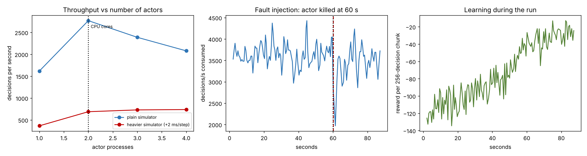

# Distributed RL Rollouts: an Actor-Learner Training System

[](https://github.com/f20220970-debug/distributed-rl-rollouts/actions/workflows/tests.yml)

Built for **DP World Group AI/ML's PS-II Project 4** (*distributed infrastructure for ML research and
deployment*). It's a small version of the architecture big RL labs use (IMPALA-style actors and a learner),
built from scratch with Python multiprocessing and PyTorch. Many processes generate experience in parallel,
one learner trains on it, and the system reports throughput, latency, policy lag and how it recovers when a
worker crashes.

The workload is the port terminal simulator from
[container-terminal-rl](https://github.com/f20220970-debug/container-terminal-rl) (quay cranes, trucks and
yard; PPO learns which crane each empty truck should serve).



## Architecture
```
 actor 0 ─┐                                   ┌─> PPO update (ratio vs the BEHAVIOUR policy's log-probs)
 actor 1 ─┼─> trajectory queue ─> learner ────┤
 actor N ─┘   (chunks of 256      drops chunks └─> publish weights to shared memory, version += 1
   ^           decisions, with    older than
   |           version + times)   max_lag
   └──────── actors copy the latest weights from shared memory before each chunk

 supervisor (in the learner loop): restarts any actor whose process dies or whose heartbeat stops
```

| Component | Design choice | Why |
| --- | --- | --- |
| Weight broadcast | PyTorch shared-memory tensors plus a version counter | no copying through the queue; actors always see the latest weights |
| Experience transport | `multiprocessing.Queue` of 256-step chunks, each tagged with policy version and timestamps | lets the learner measure lag and latency per chunk |
| Off-policy correction | the PPO ratio uses the log-probs the **actor** recorded, and chunks more than `max_lag` versions old are dropped | actors run slightly old weights; this keeps the update valid |
| Fault tolerance | a heartbeat after every chunk; the supervisor restarts dead or silent actors | one crashed worker shouldn't stop training |
| Reproducibility | Dockerfile, tests in CI, every run writes `results/results.json` | one command reproduces the numbers |

## Results (2-core machine)
**1. Throughput as actors are added** (16,384 decisions per run)

| Actors | Plain simulator (decisions/s) | Heavier simulator, +2 ms/step | Mean policy lag | Median latency |
| --- | --- | --- | --- | --- |
| 1 | 1,619 | 366 | 0.11 | 0.13 s |
| 2 | **2,770 (1.7×)** | **689 (1.9×)** | 0.25 | 0.13 s |
| 3 | 2,389 | 730 | 0.42 | 0.22 s |
| 4 | 2,080 | 738 | 0.53 | 0.32 s |

- **Scaling is near-linear up to the number of cores** (1.9× on 2 cores when the simulator is the
  bottleneck).
- **Past the core count, more actors only add lag and latency.** With the plain simulator, throughput even
  falls, because actors compete with the learner for CPU. The right number of actors depends on how
  expensive the simulator is compared with the learner, which is the kind of trade-off to measure, not guess.

**2. Stale data:** dropping everything that's even one version old (`max_lag = 0`, strictly on-policy) throws
away **30.4%** of the experience and cuts throughput to 1,850/s. Allowing up to 4 versions of lag drops
**0%** at 2,227/s, with a mean lag of only 0.41 versions, which the behaviour-policy ratio corrects for.

**3. Fault injection and learning:** a 300K-decision training run with 2 actors (87 s, 3,450 decisions/s)
where actor 0 is killed at 60 s.
- The supervisor restarted it within 0.1 s; throughput dipped for one update and recovered.
- No data was lost to staleness (mean lag 0.32, p95 = 1).
- **The policy trained this way matches the single-process PPO:** 26.80 crane moves/hour on 20 held-out
  ships, against 26.76 for the best dispatching rule (fewest assigned), 24.80 for dedicated trucks and
  20.59 for random.

## Run it
```bash
pip install -r requirements.txt
pytest -q                    # 2 end-to-end tests (~30 s): runs to completion; restarts a killed actor
python run_experiments.py    # all results above (~10 min) -> results/results.json, docs/results.png
# or with Docker:
docker build -t drl . && docker run --rm -v "$PWD/results:/app/results" -v "$PWD/docs:/app/docs" drl
```

## Limitations and next steps
- One machine with 2 cores, so scaling beyond 2 is shown as oversubscription, not a cluster. The same design
  maps to Ray actors, or to Redis or Kafka for the queue across machines.
- The learner is a single process on CPU. A GPU learner with batched inference on the actors' behalf (SEED
  RL-style) would be the next step.
- PPO with lag-based dropping is a simple off-policy fix. V-trace (IMPALA) would let it use staler data
  safely.

Built by Pavitra Seth (BITS Pilani) as preparation for DP World's PS-II. Not affiliated with DP World.
